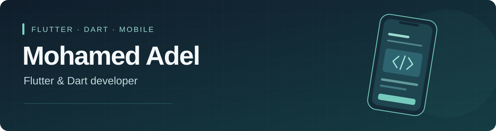

  

I'm a Flutter and Dart developer building mobile apps with a focus on clear app structure, useful user flows, and integrations.

## Tech shown in my projects

  
  
  
  
  
  
  

Flutter · Dart · Firebase · Firestore · Provider · BLoC · REST/API integrations

## Featured projects

### 01 · LearnHub
A Flutter e-learning app with student and instructor flows, Firebase authentication and Firestore, and YouTube playlist lessons.

[View the repository](https://github.com/menofy/LearnHub)

---

### 02 · Rafiq
A Flutter app organized around specialist, guardian, admin, and authentication features, using a feature-based Clean Architecture structure. The repository README describes Jitsi video appointments embedded through a WebView.

[View the repository](https://github.com/menofy/raafiq)

---

### 03 · smartHire
A Flutter project with candidate and HR areas, plus CV, interview, invite, onboarding, and practice modules in its source structure.

[View the repository](https://github.com/menofy/smartHire)
